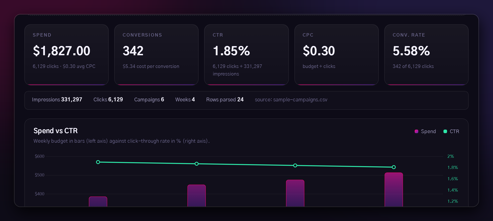

<!-- Profile README — rendered on https://github.com/mouadaddoux-cpu -->

  

  

<h1 align="center">MOUAD ADDOU</h1>

  <strong>Front-end engineer · I build small, fast, local-first web products.</strong> 
  Casablanca, Morocco

  
  
  

---

### Currently building

<table>
  <tr>
    <td width="52%" valign="top">
      <h3>MOUAD — campaign analytics in the browser</h3>
      

        Drop a CSV exported from Meta, Google, LinkedIn or TikTok and get the five numbers that
        matter — spend, conversions, CTR, CPC, conversion rate — plus a spend-vs-CTR trend chart
        and the campaigns that are actually worth scaling.
      

      

        No backend, no account, no upload: the file is parsed with <code>FileReader</code> and
        never leaves the tab.
      

      

        <a href="https://mouadaddoux-cpu.github.io/mouad-analytics/"><strong>Open the dashboard →</strong></a>
        &nbsp;·&nbsp;
        <a href="https://github.com/mouadaddoux-cpu/mouad-analytics">Source</a>
      

    </td>
    <td width="48%" valign="top">
      
    </td>
  </tr>
</table>

  
  
  
  
  

Numbers from the 24-row sample dataset that ships with the project.

---

### How I build

- **Local-first.** If a feature can run in the browser, it does. Fewer servers, fewer leaks, instant feedback.
- **Vanilla by default.** No framework until it earns its weight — MOUAD is plain HTML, CSS and JS with one dependency for charts.
- **Small surfaces.** One job per page, one obvious action, no settings maze. If a screen needs a tutorial, the screen is wrong.
- **Honest numbers.** Every metric is recomputed from the raw totals, never averaged from averages.

### Toolbox

  
  
  
  
  
  

### Projects

| Project | What it is | Stack |
| --- | --- | --- |
| **[mouad-analytics](https://github.com/mouadaddoux-cpu/mouad-analytics)** | Campaign analytics dashboard — drop a CSV, get KPIs, spend-vs-CTR trends and flagged winners. [Live demo →](https://mouadaddoux-cpu.github.io/mouad-analytics/) | Vanilla JS · Chart.js · no backend |

More work lives in the pinned repositories below.

---

  Open to front-end work and product collaborations — <a href="mailto:mousaddadoux@gmail.com">mousaddadoux@gmail.com</a>

